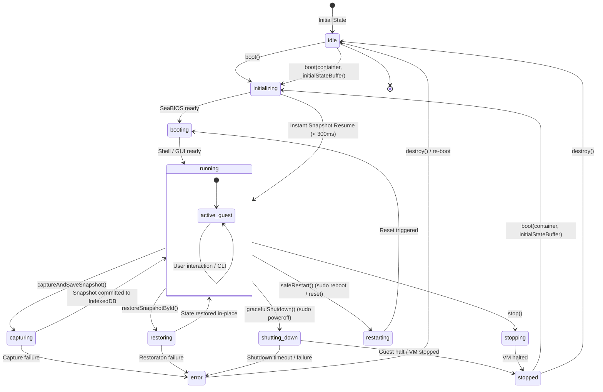

# Snapshot Lifecycle & State Machine Architecture

**Project:** WebOS — Browser-Hosted x86 Linux Environment  
**Component:** Virtual Machine Snapshot Lifecycle  
**Phase:** Phase 6 — Persistence & System Management  
**Date:** 2026-11-21  
**Status:** Completed & Formally Specified  

---

## 1. Overview & Objectives

In WebOS, capturing and restoring virtual machine snapshots requires strict state machine transitions to protect against memory corruption, race conditions, and inconsistent device registers.

This document describes:
1. The complete lifecycle state machine of `EmulatorManager`.
2. The snapshot capture pipeline.
3. The snapshot restoration pipeline (both in-place and cold-start).
4. Operation concurrency locks.
5. Error handling and recovery paths.

---

## 2. State Machine Diagram

---

## 3. Snapshot Capture Pipeline

When `captureAndSaveSnapshot(name, description, tags)` is invoked:

1. **Guard & Lock Check:**
   - Verify `status === 'running'`.
   - Check `isOperationLocked === false`. If locked, throw `OperationLockedError`.
   - Set `isOperationLocked = true; activeOperation = 'capturing'`.
   - Transition status to `'capturing'` and notify UI listeners.
2. **State Serialization:**
   - Call native `await v86Instance.save_state()`.
   - v86 iterates over CPU registers, memory pages, VGA memory, and PCI device models, returning a single contiguous `ArrayBuffer`.
3. **Metadata & Parity Generation:**
   - Generate unique snapshot ID (UUIDv4).
   - Generate deterministic `hardwareConfigHash` from active `this.config`.
   - Calculate Web Crypto SHA-256 digest of the ArrayBuffer.
   - Record active display resolution and timestamp.
4. **IndexedDB Commit:**
   - Commit record `{ metadata, data: stateBuffer }` to object store `snapshots` in IndexedDB (`webos_persistence_db`).
5. **Release & Notify:**
   - Log snapshot capture completion with byte size and SHA-256.
   - Reset `isOperationLocked = false; activeOperation = null`.
   - Transition status back to `'running'`.
   - Return `SnapshotMetadata`.

---

## 4. Snapshot Restoration Pipeline

### 4.1 In-Place Restoration (Running VM)
When restoring into an already active emulator instance:
1. Acquire operation lock (`activeOperation = 'restoring'`).
2. Set status to `'restoring'`.
3. Retrieve snapshot record and verify SHA-256 integrity.
4. Check hardware config hash parity against running `this.config`. If mismatch, abort with `HardwareMismatchError`.
5. Call `await v86Instance.restore_state(record.data)`.
6. Update screen dimensions and shell status.
7. Release lock and transition status to `'running'`.

### 4.2 Cold Start Restoration (Fresh VM / Reload)
When restoring into a fresh or stopped emulator:
1. Retrieve snapshot record and verify SHA-256 integrity.
2. Validate hardware parity.
3. Call `boot(screenContainer, record.data)`.
4. `V86` constructor receives `initial_state: { buffer: record.data }`.
5. Virtual machine immediately begins execution in running state without SeaBIOS or ISOLINUX boot steps.
6. Execution resumes in **under 300 ms**.
